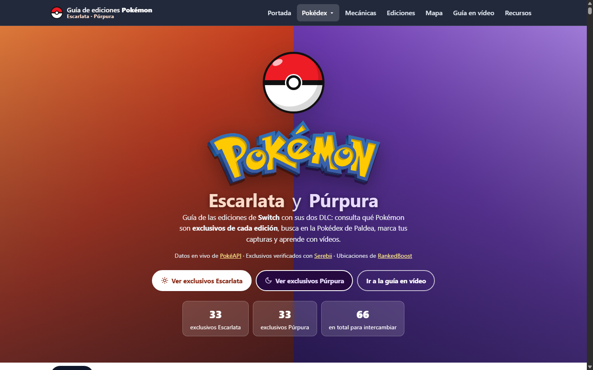

# Guía de ediciones Pokémon

**Guía web de las ediciones de Pokémon con sus exclusivos, una Pokédex completa con ubicaciones, naturalezas y sets recomendados, y guías en vídeo. Por ahora incluye Rojo Fuego y Verde Hoja y Escarlata y Púrpura.**

[](https://pokemon-rojo-fuego-verde-hojavercel.vercel.app)   




## En resumen

- **Qué es:** una web sin frameworks ni build. Cada juego tiene su página con la misma estructura y sus propios colores. Se pasa de uno a otro desde el desplegable «Pokédex» del menú.
- **Juegos:** Rojo Fuego y Verde Hoja (`index.html`) y Escarlata y Púrpura con sus dos DLC (`escarlata-purpura.html`).
- **Datos:** PokéAPI para estadísticas, evoluciones y ataques; RankedBoost para las ubicaciones; Serebii para los exclusivos de Escarlata y Púrpura.
- **Destacado:** cada ficha calcula la naturaleza óptima a partir de las estadísticas base, propone un set de cuatro ataques con las reglas de la generación del juego y muestra dónde capturar el Pokémon con su probabilidad.
- **Calidad:** accesible con teclado, responsive y con datos de respaldo si falla la API.

## Qué tiene cada juego


| | Rojo Fuego y Verde Hoja | Escarlata y Púrpura |
| --- | --- | --- |
| **Pokédex** | 251 Pokémon (Kanto y Johto) | 664 Pokémon (Paldea, Noroteo y Arándano) |
| **Exclusivos** | 22 de Rojo Fuego y 23 de Verde Hoja | 33 de Escarlata y 33 de Púrpura (juego base y DLC) |
| **Set recomendado** | Reglas de la 3.ª generación: el tipo decide si un ataque es físico o especial | Reglas de la 9.ª generación: cada ataque tiene su categoría |
| **Mapa** | Kanto y las Archi7 (RankedBoost) | Paldea (RankedBoost) |
| **Guía en vídeo** | 36 capítulos y 50 shorts | 37 episodios y 69 vídeos de trucos |

En los dos:

- **Pokédex:** buscador y filtro por región. Cada ficha muestra dónde se captura (zona, método, niveles y probabilidad), la naturaleza recomendada y una alternativa, el set recomendado (potencia, STAB y cobertura), la cadena evolutiva y los ataques por nivel, MT y tutor. Se pueden marcar los capturados y se guardan en el navegador, por separado para cada juego.
- **Ediciones:** los exclusivos de cada edición, con su ficha al pulsar.
- **Mecánicas:** las 25 naturalezas con su efecto y uso, los 18 tipos y la tabla de eficacias 18×18.
- **Recursos:** enlaces oficiales y guías.

La interfaz es accesible con teclado (pestañas con flechas, modal y desplegable con Escape y foco gestionado) y funciona en móvil.

## Datos

- **Estadísticas, tipos, evoluciones y ataques:** PokéAPI, con caché en memoria y datos locales de respaldo si falla la conexión. Los ataques se filtran por los grupos de versión de cada juego (`firered-leafgreen`; `scarlet-violet`, `the-teal-mask` y `the-indigo-disk`).
- **Rojo Fuego y Verde Hoja:** ubicaciones de Kanto de la [Pokédex FRLG de RankedBoost](https://rankedboost.com/pokemon/pokedex/firered-leafgreen/), guardadas en `src/js/data.js`. Para Johto se usan los encuentros de PokéAPI. Exclusivos contrastados con las guías del relanzamiento (febrero de 2026) y con RankedBoost. Potencias, precisiones y tipos de la 3.ª generación (PokéAPI los da en `past_values`).
- **Escarlata y Púrpura:** `src/js/data-sv.js` se genera con `tools/build_sv_data.py`, que junta las tres Pokédex regionales de PokéAPI (con los nombres oficiales en español), los [exclusivos de Serebii](https://www.serebii.net/scarletviolet/exclusives.shtml) y las ubicaciones de RankedBoost, con las zonas traducidas a sus nombres oficiales (Área 1 del sur, Sierra Napada, Bosquejada...). RankedBoost no tiene páginas para los Pokémon de los DLC, así que esas fichas enlazan a Serebii. Las formas regionales que salen en el juego (Wooper y Tauros de Paldea, Vulpix y Sandshrew de Alola) se muestran con su forma. Tauros de Paldea se explica en una nota, porque sus razas Llameante y Acuática comparten el nº 128.
- **Naturalezas y sets:** calculados en `src/js/mechanics.js` a partir de las estadísticas base y de los ataques que aprende en el juego.
- **Imágenes de cabecera de Rojo Fuego y Verde Hoja:** recortes de una tabla de exclusivos, generados con los scripts de `tools/`.

## Ejecutarlo

No necesita instalación: basta con abrir `index.html` en el navegador (hace falta conexión para PokéAPI, el mapa y los vídeos). Para desarrollar, mejor con un servidor local:

```bash
python -m http.server 5500   # http://localhost:5500
```

## Estructura

```text
├── index.html                # Rojo Fuego y Verde Hoja
├── escarlata-purpura.html    # Escarlata y Púrpura (misma estructura)
├── src/
│   ├── styles/main.css       # Estilos (variables; colores de cada juego en body[data-game])
│   ├── assets/cutouts/       # Recortes de los exclusivos de RFVH (fire/ y leaf/)
│   └── js/
│       ├── games.js          # Configuración de cada juego (nombres, generación, versiones de PokéAPI)
│       ├── data.js           # Datos de RFVH: exclusivos, Pokédex 1-251, tipos y ubicaciones
│       ├── data-sv.js        # Datos de Escarlata y Púrpura (generado)
│       ├── mechanics.js      # Naturalezas, tabla de tipos y set recomendado
│       ├── api.js            # Llamadas a PokéAPI con caché
│       ├── ui.js             # Tarjetas, Pokédex, modal y avisos
│       ├── playlist.js       # Vídeos de RFVH
│       ├── playlist-sv.js    # Vídeos de Escarlata y Púrpura
│       └── app.js            # Pestañas, menú, eventos y arranque
└── tools/                    # Scripts de datos e imágenes (Python)
```

Cada página carga `games.js`, sus datos y su playlist, y después los scripts comunes. Para añadir otro juego basta con una entrada nueva en `GAMES`, sus ficheros de datos y playlist, una página HTML y una opción en el desplegable.

Para regenerar los datos de Escarlata y Púrpura (descarga unas 700 especies; la caché evita repetirlo):

```bash
python tools/build_sv_data.py [carpeta_de_cache]
```

Para regenerar los recortes de Rojo Fuego y Verde Hoja:

```bash
python tools/crop_exclusives.py ruta/a/la/tabla.jpg
python tools/clean_cutouts.py
```

## Autor

Álvaro Domingo Cordón · [LinkedIn](https://www.linkedin.com/in/alvaro-domingo/) · [GitHub](https://github.com/alvarodc093-pixel)

Pokémon y sus nombres son marcas de Nintendo, Game Freak y The Pokémon Company. Proyecto personal sin ánimo de lucro.
