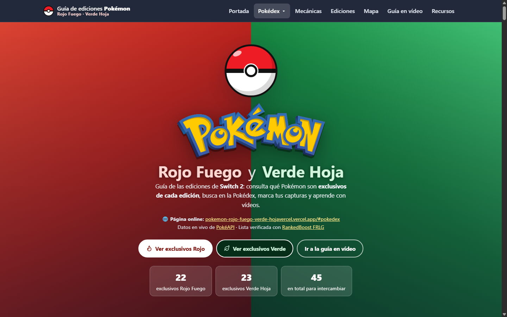
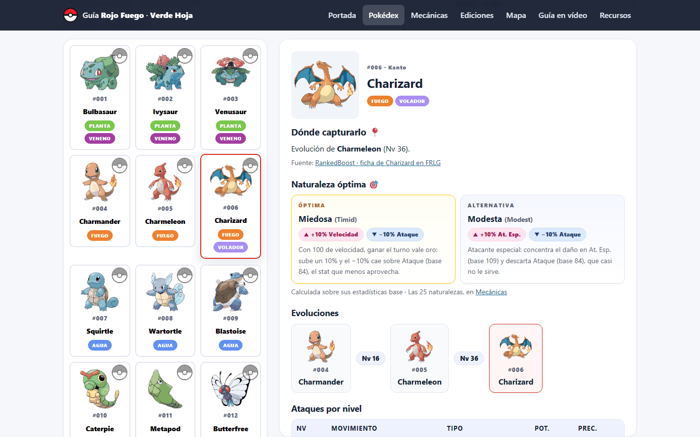

# Guía Pokémon Rojo Fuego y Verde Hoja

**Guía web de las ediciones Rojo Fuego y Verde Hoja: Pokédex de 251 Pokémon, exclusivos de cada edición, ubicaciones, naturalezas y guía en vídeo.**

[](https://pokemon-rojo-fuego-verde-hojavercel.vercel.app)   



## En resumen

- **Qué es:** una web sin frameworks ni build que combina datos en vivo de PokéAPI con datos propios de ubicaciones y naturalezas.
- **Datos:** PokéAPI para estadísticas, evoluciones y ataques; RankedBoost para las ubicaciones de Kanto.
- **Destacado:** cada ficha calcula la naturaleza óptima a partir de las estadísticas base y muestra dónde capturar el Pokémon con su probabilidad.
- **Calidad:** accesible con teclado, responsive y con datos de respaldo si falla la API.

## Qué tiene



- **Pokédex (1–251):** buscador y filtro por región. Cada ficha muestra dónde se captura (zona, método, niveles y probabilidad), la naturaleza recomendada según sus estadísticas base y una alternativa, un set recomendado de cuatro ataques (potencia, STAB y cobertura con las reglas de la 3.ª generación), la cadena evolutiva y los ataques por nivel, MT/MO y tutor. Se pueden marcar los capturados y se guardan en el navegador.
- **Ediciones:** los 22 exclusivos de Rojo Fuego y los 23 de Verde Hoja, con su ficha al pulsar.
- **Mecánicas:** las 25 naturalezas con su efecto y uso, los 18 tipos y la tabla de eficacias 18×18.
- **Mapa:** mapa interactivo de Kanto (RankedBoost).
- **Guía en vídeo:** reproductor con 36 capítulos y 50 shorts.
- **Recursos:** enlaces oficiales y guías.

La interfaz es accesible con teclado (pestañas con flechas, modal con Escape y foco gestionado) y funciona en móvil.

## Datos

- **Estadísticas, tipos, evoluciones y ataques:** PokéAPI, con caché en memoria y datos locales de respaldo si falla la conexión.
- **Ubicaciones de Kanto:** [Pokédex FRLG de RankedBoost](https://rankedboost.com/pokemon/pokedex/firered-leafgreen/), guardadas en `src/js/data.js`. Para Johto se usan los encuentros de PokéAPI.
- **Exclusivos:** contrastados con las guías del relanzamiento (febrero de 2026) y con RankedBoost. Deoxys es un caso aparte (forma Ataque en Rojo Fuego y Defensa en Verde Hoja) y se explica en una nota, porque PokéAPI lo sirve como un único Pokémon.
- **Naturalezas:** calculadas en `src/js/mechanics.js` a partir de las estadísticas base de cada Pokémon.
- **Set recomendado:** elegido en `src/js/mechanics.js` entre los ataques que aprende en RFVH (nivel, MT/MO y tutor). Potencias, precisiones y tipos de la 3.ª generación (PokéAPI los da en `past_values`), y la categoría física o especial la decide el tipo del ataque.
- **Imágenes de cabecera:** recortes de una tabla de exclusivos, generados con los scripts de `tools/`.

## Ejecutarlo

No necesita instalación: basta con abrir `index.html` en el navegador (hace falta conexión para PokéAPI, el mapa y los vídeos). Para desarrollar, mejor con un servidor local:

```bash
python -m http.server 5500   # http://localhost:5500
```

## Estructura

```text
├── index.html              # Estructura, SEO y accesibilidad
├── src/
│   ├── styles/main.css     # Estilos (variables, responsive)
│   ├── assets/cutouts/     # Recortes de los exclusivos (fire/ y leaf/)
│   └── js/
│       ├── data.js         # Exclusivos, Pokédex 1-251, tipos y ubicaciones
│       ├── mechanics.js    # Naturalezas y tabla de tipos
│       ├── api.js          # Llamadas a PokéAPI con caché
│       ├── ui.js           # Tarjetas, Pokédex, modal y avisos
│       ├── playlist.js     # Vídeos de la guía
│       └── app.js          # Pestañas, eventos y arranque
└── tools/                  # Scripts para regenerar los recortes (Python + Pillow + NumPy)
```

Para regenerar los recortes:

```bash
python tools/crop_exclusives.py ruta/a/la/tabla.jpg
python tools/clean_cutouts.py
```

## Autor

Álvaro Domingo Cordón · [LinkedIn](https://www.linkedin.com/in/alvaro-domingo/) · [GitHub](https://github.com/alvarodc093-pixel)

Pokémon y sus nombres son marcas de Nintendo, Game Freak y The Pokémon Company. Proyecto personal sin ánimo de lucro.
